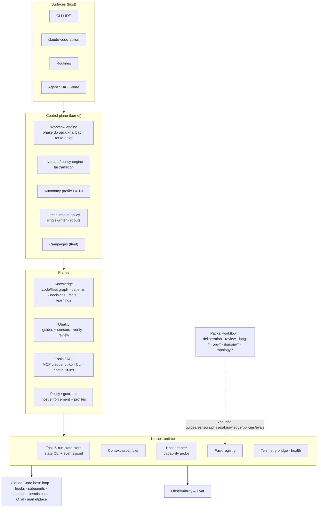

# 03 — Kiến trúc tham chiếu: ClaudeHut Harness 0.20

## 1. Nguyên tắc

| # | Nguyên tắc | Chống lại | Nguồn |
|---|---|---|---|
| P1 | **Host-first.** Claude Code đã có loop, sandbox, permission, marketplace, OTel, trigger. Kernel chỉ lấp khoảng trống; phần còn lại là cấu hình (profile) | xây lại cái host có, rồi lệch khi host đổi | [02 §3](02-research.md) |
| P2 | **Kernel nhỏ, ổn định. Mọi tri thức stack, tổ chức, domain nằm trong pack có version** | DOM-1, DOM-2 (RC3) | Böckeler templates; OpenHands two-layer |
| P3 | **Guide đi cùng sensor.** Mỗi control có stage, ưu tiên computational, output viết cho model đọc | VER-*, PLN-1 | Böckeler |
| P4 | **Cưỡng chế bằng bất biến tại chuyển trạng thái tường minh.** Không dùng regex trên file, không bỏ mặc. Hook vẫn advisory | STA-1, VER-1 (RC1) | 12-factor #8 |
| P5 | **Mọi control quan sát được:** có canary chứng minh nó chạy, có metric | VER-3, OBS-* (RC2) | Böckeler meta-sensor |
| P6 | **Thế giới mở:** dò host, plugin khác, wrapper, stack rồi thích nghi; không giả định | ENV-1, CMP-2 (RC3) | — |
| P7 | **Phân phối bằng tham chiếu có version**, không copy | LIF-1, LIF-2, MAO-2 (RC4) | plugin dependencies |
| P8 | **Tri thức có vòng đời:** provenance, xác minh, owner, version, retract | KNW-1, KNW-2, VER-2 (RC5) | Graphiti, Reflexion |
| P9 | **Runtime có kiểu, không dùng shell làm runtime.** Migrate dần theo kiểu strangler | ENV-4, ACI-4 (RC6) | — |
| P10 | **Một writer mỗi repo/branch;** scout chỉ đọc; writer song song phải chung log quyết định | ENV-2, MAO-3 | Cognition; OpenAI guide |
| P11 | **Phê duyệt ở lại trong platform.** Không tạo "grant" để agent hay session khác vượt auto-mode hoặc sự đồng ý của peer | HIL-1, MAO-1 | permission-modes |
| P12 | **Context nhỏ, prefix ổn định, nạp khi cần, có budget** | CTX-*, PLN-3 | Manus; Anthropic CE |
| P13 | **Thay đổi harness theo eval so với baseline**, qua canary | EVL-*, EVL-4 | skill-creator; Hamel |
| P14 | **Quy tắc neo:** mọi component phải truy về ≥1 vấn đề (§5) hoặc ≥1 nguyên tắc. Không neo thì không xây | over-engineering của chính harness | Protected Variation áp lên harness |

## 2. Mô hình capability và chủ sở hữu

Owner: **host** (Claude Code làm), **kernel** (ClaudeHut kernel làm), **pack** (pack cung cấp nội dung), **profile** (ClaudeHut sinh cấu hình cho host, chỉ ghi khi user đồng ý).

| # | Capability | Owner | ClaudeHut cung cấp |
|---|---|---|---|
| C1 | Agent loop | host | — |
| C2 | Context assembly | host + kernel | digest, budget, handoff/progress, nạp theo trigger (K4) |
| C3 | Cache stability | kernel (policy) | không nội dung biến động trong phần always-on; tool set ổn định |
| C4 | Guides | pack | skill, rule theo `paths`, template; kernel kiểm budget |
| C5 | Sensors | pack + kernel | hợp đồng sensor, runtime, `claudehut-verify` (K7) |
| C6 | Staging của control | kernel | gắn sensor vào stage: transition, hook, pre-commit, CI, lịch |
| C7 | Rủi ro tool | host + pack | deny rule, PreToolUse cho bất biến domain (pack policy) |
| C8 | Thang autonomy | profile | L0–L3 → permission mode, allow/deny (K5) |
| C9 | Sandbox | host + profile | profile `denyRead` credential, allowlist domain |
| C10 | Human-in-the-loop | host + kernel | giao thức escalate từ delegate lên main; câu hỏi có cấu trúc |
| C11 | Durable run state | kernel | state CLI và event log theo task (K1) |
| C12 | Compaction | host + kernel | handoff artifact cạnh log, không thay log |
| C13 | Orchestration | host + kernel | policy single-writer, scout chỉ đọc, log quyết định chung |
| C14 | Planning, recitation | pack + kernel | phase do pack khai báo; `progress.md`, feature list |
| C15 | Trigger, surface | host + profile | profile cho CI action, routine, headless `--bare` |
| C16 | Knowledge | kernel + pack | knowledge service + MCP (K6); extractor do pack cung cấp |
| C17 | Phân phối, version | host + kernel | kernel/pack/bundle, marketplace stable/canary (K10) |
| C18 | Policy, governance | host + profile | mẫu managed settings |
| C19 | Observability, cost | host + kernel | event → OTel GenAI, `claudehut status` (K9) |
| C20 | Eval, cải tiến | host + kernel | suite outcome/decision/env, vòng cải tiến (K11) |
| C21 | Deliberation (quyết định thiết kế) | pack | `deliberation` pack ([appendix/a2](appendix/a2-deliberation-pack.md)) |
| C22 | Điều phối fleet, xuyên repo | kernel | campaign, task xuyên repo, ownership (K8). Host chỉ có tin nhắn giữa session |

## 3. Phân lớp

## 4. Kernel và pack

### 4.1 Các component kernel (chi tiết ở [04](04-kernel-control.md))

| ID | Component | Neo (vấn đề) |
|---|---|---|
| K1 | Task & run-state store: state CLI là writer duy nhất; `events.jsonl` append-only; `task.json` là projection | STA-1, OBS-1, MAO-4, CTX-1 |
| K2 | Invariant/policy engine: bất biến do kernel và pack khai báo, kiểm tại transition; `--override` có lý do | STA-1, VER-1, PLN-3, HIL-2 |
| K3 | Workflow engine: chạy phase do pack khai báo; route × tier rủi ro | PLN-5, DOM-1 |
| K4 | Context assembler: digest, budget, handoff, recitation | CTX-1, CTX-2, PLN-3 |
| K5 | Host adapter: dò host, plugin, wrapper; sinh profile autonomy và sandbox; thích nghi | ENV-1, ACI-3, CMP-2, HIL-1, HIL-3 |
| K6 | Knowledge service: index, hub, MCP `claudehut-kb`, bảo trì sự thật | KNW-1/2/3, ACI-1, SEC-1 |
| K7 | Sensor runtime + `claudehut-verify` | VER-1/2/3, ACI-2 |
| K8 | Coordination: campaign, task xuyên repo, ownership | MAO-1, MAO-2 |
| K9 | Telemetry bridge + `claudehut status` | OBS-1/2, DX-2, VER-3 |
| K10 | Pack registry: kích hoạt theo detect, kiểm budget always-on | DOM-1, CMP-2, LIF-2 |
| K11 | Eval runner: outcome, decision, env-hostile, baseline | EVL-1/2/3/4 |

### 4.2 Extension points (chi tiết ở [07](07-packs-distribution.md))

Pack là một Claude Code plugin phụ thuộc `claudehut-kernel` theo semver. Pack khai báo `claudehut-pack.json`:

| Loại | Trường bắt buộc |
|---|---|
| `guide` | trigger (`always`, `paths`, `llm`, `human`, `hook`), token budget |
| `sensor` | stage, kind (`computational`/`inferential`), cost class, format thông điệp, **canary** (input xấu đã biết) |
| `invariant` | transition, điều kiện, severity (`block`/`warn`) |
| `phase` | tên, artifact, invariant vào/ra |
| `knowledge` | extractor (ngôn ngữ, framework), fact, pattern seed |
| `tool` | MCP/CLI, rating rủi ro |
| `trigger` | profile CI, routine |
| `eval` | case và grader |
| `detect` | điều kiện kích hoạt (file marker, dependency) |

## 5. Ma trận coverage (mọi S1 và S2)

Mỗi dòng: vấn đề → owner → cơ chế → đo bằng gì. Cột Track: **Q** = quick-win 0.12.x, **0.20** = kiến trúc mới.

| Vấn đề | Sev | Owner | Cơ chế | Eval / metric | Track |
|---|---|---|---|---|---|
| PLN-1 quyết định hẹp | S1 | pack `deliberation` + K6 | variation probe, quy tắc PV hai chiều, MADR, design-reviewer ([a2](appendix/a2-deliberation-pack.md)) | decision suite should/should-not abstract | 0.20 |
| VER-1 claim chưa kiểm | S1 | K7 + K2 | `verify claims/verdict/findings`; bất biến `set-review pass` | case claim-integrity; false-PASS = 0 | **Q** |
| EVL-1 eval chết | S1 | K11 | `claude plugin eval` có baseline; budget đúng; CI định kỳ | Δ có số; chạy hằng tuần | **Q** |
| VER-3 control câm | S1 | K7 + K9 | mọi sensor/hook có canary; `claudehut status --selftest` | 100% control có canary pass | 0.20 (Q: canary cho hook hiện có) |
| STA-1 done khi chưa review | S1 | K2 | bất biến `end done ⇒ review ∉ {pending, stale}` (nếu route cần) | 0 task vi phạm | **Q** |
| ENV-1 (+CMP-1) worktree refusal | S1 | K5 | probe phát hiện hook rewrite (rtk); profile cho subagent worktree (lệnh tuyệt đối/bỏ qua wrapper); cảnh báo user | số refusal/tuần | **Q** (detect) → 0.20 |
| MAO-1 điều phối tay | S1 | K8 | campaign object, task xuyên repo, owner, trạng thái tổng; escalation lên user, không chuyển approval | số tin nhắn tay mỗi campaign | 0.20 |
| KNW-2 learning sai | S1 | K6 | vòng đời learning; promote cần `verified_by`; retract; tách "harness learning" khỏi project | 0 learning chưa xác minh ở fleet | **Q** (retract F-0054/F-0080) → 0.20 |
| DOM-1 lõi Java | S1 | K10 + packs | kernel không có khái niệm Spring; pack `lang-java-spring` kích hoạt khi detect | walkthrough repo không Java (§6) | 0.20 |
| CTX-1 cạn context | S2 | K1 + K4 | session theo task, handoff `progress.md`, resume từ log | số continuation/compaction mỗi task | 0.20 |
| CTX-2 context lạ | S2 | K10 | chỉ nạp pack khớp detect | 0 rule ngoài stack | 0.20 |
| KNW-1 learnings chết | S2 | K6 | retrieval theo task, tín hiệu hữu ích, TTL, dọn | tỉ lệ hit; kích thước store | 0.20 |
| KNW-3 index mù thiết kế | S2 | K6 + pack lang | schema 3: supertypes, variation point, decision ([05](05-knowledge-plane.md)) | precision/recall detector | 0.20 |
| PLN-2 làm sai yêu cầu | S2 | pack workflow + K2 | bước xác nhận yêu cầu (AC tóm tắt) trước implement ở light/full; headless không tự duyệt | số rollback do sai yêu cầu | 0.20 |
| PLN-3 artifact quá budget | S2 | K2 + K4 | budget là bất biến `warn→block` theo tier, đếm bằng máy | p90 số từ của plan/spec | **Q** |
| PLN-5 route không quan sát được | S2 | K1 + K3 | mọi request ghi sự kiện route/tier (kể cả direct); escalate theo tín hiệu rủi ro | phân bố route/tier | 0.20 |
| ACI-1 grep lỗi bị hiểu là "không có" | S2 | K6 | tool có kiểu, phân biệt `unknown`/`none_found`; guide "error ≠ absence" | case env-hostile | 0.20 |
| ACI-2 wrapper làm sai bằng chứng | S2 | K5 + K7 | phát hiện wrapper; sensor chạy raw (`command -p`/đường dẫn tuyệt đối) | case rtk fixture | **Q** |
| ENV-2 worktree manager lỗi | S2 | host + K5 | dùng `isolation: worktree` của host, bỏ dần `claudehut-worktree`; check-disjoint đủ build file | lỗi reconcile | 0.20 |
| VER-2 validator không gắn version | S2 | pack org + K7 | sensor khai báo `library@version`; lệch thì WARN | 0 ERROR giả sau bump | 0.20 |
| VER-5 chi phí review | S2 | pack review + K9 | lane theo diff; đo cost/lane | cost/task | 0.20 |
| MAO-2 rollout bằng script | S2 | K8 | campaign + prompt template tham chiếu (không copy) + addendum | số bản copy lệch | 0.20 |
| MAO-4 treo, không resume | S2 | K1 | checkpoint ở transition; agent trả kết quả từng phần; heartbeat qua event | thời gian khôi phục | 0.20 |
| HIL-1 approval không tới delegate | S2 | K5 + profile | profile quyền do user sở hữu; delegate escalate lên main; push/PR chỉ ở main | số denial/tuần | 0.20 |
| HIL-2 duyệt dưới áp lực / headless tự duyệt | S2 | K2 | headless không qua gate T2+; override ghi lý do | tỉ lệ override | 0.20 |
| OBS-1 ledger mất | S2 | K1 + K9 | nguồn sự thật là state CLI; hook chỉ làm giàu, đối soát | event mất < 1% | 0.20 |
| OBS-2 claim không đo lại | S2 | K9 + K11 | metric release là test chạy định kỳ | dashboard metric | **Q** |
| EVL-2 không eval quyết định | S2 | K11 + deliberation | decision suite | Δ | 0.20 |
| EVL-4 cải tiến thủ công | S2 | K11 | mining transcript → đề xuất PR → eval → canary | chu kỳ cải tiến | 0.20 |
| LIF-1 cài theo repo | S2 | profile + host | cài user/managed scope; bundle; auto-update; cảnh báo session chạy bản cũ | số version cùng lúc | 0.20 |
| LIF-2 copy asset | S2 | K10 + packs | skill/checker/prompt ship trong pack plugin; repo tham chiếu | 0 bản copy | 0.20 |
| CMP-2 thế giới đóng | S2 | K5 + K10 | registry thấy skill/agent của plugin khác; policy cùng tồn tại | case compose | 0.20 |
| DOM-2 Summer KB nhúng lõi | S2 | pack `org-summer` | tách thành pack có version, phát hành riêng | release core không vì Summer | 0.20 |
| SEC-1 learning thành kênh inject | S2 | K6 | learning là dữ liệu được trích dẫn, sanitize, có provenance; không inject như chỉ dẫn | case injection | 0.20 |
| DX-1 chậm, đắt | S2 | K3 + K9 | tier quyết định mức nghi thức; đo cost/task | cost/task theo tier | 0.20 |

**Coverage:** 35/35 vấn đề S1 và S2 có cơ chế và metric. Mọi component K1–K11 đều có neo. Các vấn đề S3 được gom vào component tương ứng: ENV-3..5 → K5; ACI-3, ACI-4 → K5, K1; KNW-4..6 → K6; STA-2..4 → K1; LIF-3..5 → K10, P9; SEC-2..4 → K7, profile.

## 6. Kiểm tra tính tổng quát: hai walkthrough

### 6.1 Fleet Spring (ewallet): campaign DR + feature flag cho 14 service

1. **Kích hoạt pack.** `org-summer` cung cấp skill `using-dr-summer` và checker gắn `summer@0.3.31`. `domain-ewallet` cung cấp domain facts và template campaign. `lang-java-spring` cung cấp extractor, ArchUnit sensor và rule.
2. **Tạo campaign.** Owner tạo campaign `dr-featureflag` từ hub, gồm template tham chiếu cùng addendum từng service. Kernel tạo task con ở 14 repo, ghi owner và trạng thái. Sửa template thì mọi task thấy bản mới, không còn 14 bản copy.
3. **Mỗi task chạy trong session riêng.** Sensor checker có canary; vi phạm bất biến `end done` thì bị chặn; tier T2 cho các thay đổi thuộc money path.
4. **Theo dõi.** `claudehut status --campaign dr-featureflag` cho biết repo nào đang dở, repo nào đang chờ duyệt. Khi cần quyết định, kernel escalate lên user; user duyệt trong session của repo đó.

### 6.2 Repo đơn không Java: chính repo `claudehut` (bash/python)

1. **Kích hoạt pack.** Detect thấy không có JVM, nên chỉ nạp `claudehut-kernel`, `workflow-standard`, `deliberation` và `lang-python-shell` (extractor: hàm, module; sensor: `shellcheck`, `pytest`, suite trong `evals/`). Không sinh `PROJECT.md` Java, không có rule Spring.
2. **Knowledge.** Variation point là "nhiều script cùng một vai trò", ví dụ các hook `*.sh` cùng hợp đồng. Pattern được mine bằng extractor của pack.
3. **Deliberation.** Áp đúng quy tắc PV, chỉ thay detector.
4. **Thiếu hub vẫn chạy.** Không có hub thì tool trả `scope: service`.

Kết luận: không component kernel nào cần khái niệm Spring. Spring chỉ xuất hiện trong pack.
