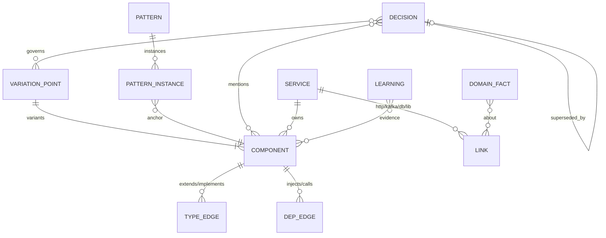
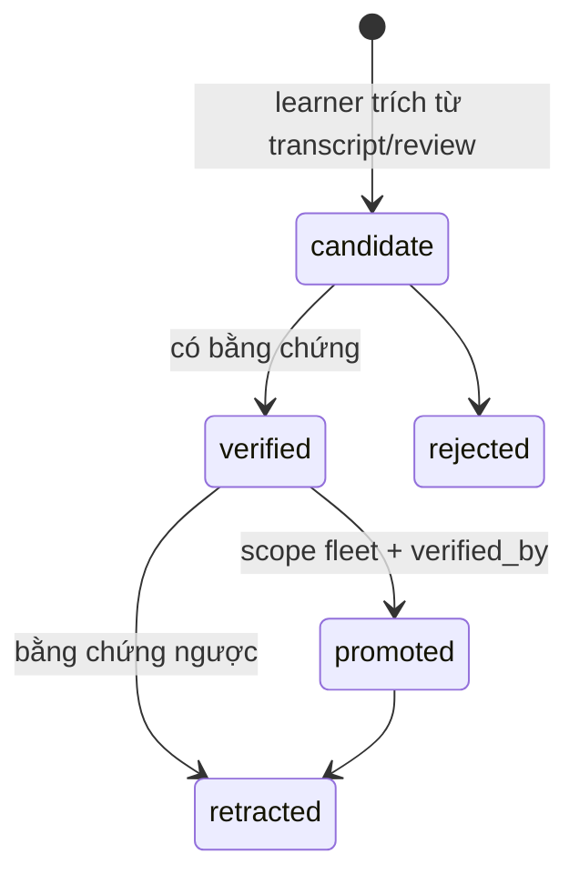

# 05 — Knowledge plane: tri thức và MCP `claudehut-kb`

Component K6 ([03 §4](03-reference-architecture.md)). Mục tiêu: agent trả lời bằng tool, không bằng grep, các câu hỏi về code, fleet, quyết định và nghiệp vụ, và mọi fact trả về đều có nguồn gốc cùng trạng thái xác minh.

Vấn đề neo: KNW-1, KNW-2, KNW-3, ACI-1, SEC-1, VER-2, KNW-4..6.

**Phân chia kernel và pack.**
- Kernel định nghĩa schema, kho, vòng đời fact, MCP server và interface extractor.
- Extractor theo ngôn ngữ/framework (Java/Spring, Python, shell, Kafka, Flyway…) và pattern seed do **pack** cung cấp. Kernel không có khái niệm Spring (DOM-1).

## 1. Mô hình dữ liệu (index schema 3, hub schema 3)

| Thực thể | Nội dung | Nguồn sinh | Mới so với 0.12 |
|---|---|---|---|
| COMPONENT | như 0.12, thêm `supertypes[]`, `generics`, cả interface/abstract thường | `extract.py` | lưu `extends/implements` (đang parse rồi bỏ, `extract.py:353-354`) |
| TYPE_EDGE | `sub → super` | extract; tuỳ chọn SCIP | mới |
| DEP_EDGE | inject qua constructor/field, gọi bean (nội service) | extract (constructor params, `@RequiredArgsConstructor` fields) | mới |
| VARIATION_POINT | interface/abstract có N impl; registry `Map<String,X>`/`List<X>`/`EnumMap`; factory; `@ConditionalOnProperty` theo provider; `@ConfigurationProperties` theo provider; switch/if-chain trên enum hoặc vendor | detector (§2) | mới |
| PATTERN | họ giải pháp có tên, file canonical, công thức "thêm một biến thể", trạng thái `candidate/confirmed/deprecated` | miner + người xác nhận | mới |
| DECISION | MADR và D-n đã harvest; `status`, `rule`, `valid_from`, `superseded_by`, `variation_point` | `claudehut-state`, harvester | mới |
| DOMAIN_FACT | luồng nghiệp vụ, mã template, producer/consumer quan trọng, "business-critical" do owner xác nhận | hub links + file `domain.md` do owner duyệt | mới |
| LEARNING | như 0.12, thêm `status: candidate/verified/promoted/retracted`, `verified_by` | learner + gate | vòng đời |

Plane dự án lưu `components.jsonl`, `edges.jsonl`, `variation.json`, `patterns.json`, `decisions/` (MADR) cùng `decisions.jsonl` (index). Hub tổng hợp `patterns.json` xuyên service (ví dụ "Provider port + Factory" xuất hiện ở notification-ms, va-ms, payment-gateway-ms).

## 2. Detector variation point và pattern (do pack cung cấp; ví dụ dưới đây là pack `lang-java-spring`)

| Detector | Tín hiệu Java/Spring | Ví dụ thật |
|---|---|---|
| D1 multi-impl | interface/abstract có ≥2 `@Component/@Service` implement | `SmsProvider` (CMC, FPT, SouthTelecom, Iris) |
| D2 registry | inject `Map<String, X>`, `List<X>`, `EnumMap<…, X>`; field `Map` khởi tạo trong constructor từ `List<X>` | `VaRefundDispatcher`, `PersonalQrStrategy` |
| D3 factory | class `*Factory`/`*Registry`/`*Dispatcher`/`*Resolver` trả về interface | `SmsProviderFactory`, `PushProviderFactory` |
| D4 conditional bean | `@ConditionalOnProperty(name=…provider…)` | — |
| D5 per-variant config | `@ConfigurationProperties` có key/class mang tên vendor (danh sách vendor lấy từ hub) | `GapOneProperties`, `tcbServiceId` |
| D6 branching | `switch`/if-chain trên enum hoặc chuỗi so với tên vendor/loại; ≥2 nhánh | `GeneratePersonalQrService` (0015) |
| D7 direct vendor | class domain inject trực tiếp class `*<Vendor>*` trong khi có D1/D3 cho concern tương tự | `ZnsSendService` → `GapOneZnsProvider` |

**Pattern miner.** Gom các instance D1–D3 có cấu trúc giống nhau thành PATTERN `candidate`, kèm file canonical (instance có nhiều test nhất và ít vi phạm nhất). Owner xác nhận qua `claudehut-index patterns confirm P-07`. Chỉ pattern `confirmed` mới tính cho quy tắc (c); pattern `candidate` chỉ hiện như gợi ý. Lý do: tránh cưỡng chế một pattern sai.

**SCIP (tuỳ chọn).** Khi cần độ chính xác cross-repo, ingest `scip-java` để lấy "find implementations". Bản stdlib vẫn là mặc định để giữ ADR-IDX-1 (tất định, không dependency).

## 3. Decision graph và harvest

- **Harvest một lần** từ 282 task có sẵn: đọc bảng D-n trong `spec.md`, `brainstorm.md`, findings. Mỗi D-n thành DECISION `status: historical`, kèm `task`, `commit` (nếu suy ra được), từ khoá, component nhắc tới.
- **Phát hiện bị thay thế:** task sau sửa cùng component/variation point trong N ngày (ví dụ 0015 → 0016 sau 7 giờ) thì ghi `superseded_by`, gắn nhãn `regret` để làm dữ liệu cho learning (xem §7) và eval.
- **Temporal:** tool chỉ trả quyết định `accepted` còn hiệu lực, trừ khi hỏi `include_superseded`. Quyết định cũ không bị xoá, theo ý tưởng temporal KG của Graphiti.

## 4. MCP server `claudehut-kb`

Stdio, Python stdlib (JSON-RPC 2.0: `initialize`, `tools/list`, `tools/call`, `resources/list`, `resources/read`), ship qua `.mcp.json` của plugin. Đọc file index; không tự reindex trong lượt gọi, chỉ báo `stale`.

**Server instructions** (đặt trong 4.096 ký tự đầu để tool search tìm thấy): "Use before adding an interface, provider, client, strategy, factory, enum value, DB column or module; before deciding between designs; when asked what depends on X or how this repo does Y."

| Tool | Input | Output (concise mặc định, ≤2k token; detailed ≤8k) | Thay cho |
|---|---|---|---|
| `kb_brief` | `task_text`, `budget_tokens=1000` | bản đồ xếp hạng: component, pattern, quyết định, service liên quan | `claudehut-index brief` |
| `kb_variation_points` | `scope` (concern/package/service), `include_fleet` | danh sách VP: loại D1–D7, số biến thể, file, pattern gắn kèm | mới |
| `kb_patterns` | `concern` | pattern confirmed + candidate, file canonical, công thức thêm biến thể, nơi lệch | mới |
| `kb_impact` | `symbol\|file\|topic\|endpoint` | caller trong service, edge cross-service, test phủ, quyết định nhắc tới | `links` + grep |
| `kb_decisions` | `topic\|component\|vp`, `include_superseded` | DEC tóm tắt, rule, trạng thái, chuỗi supersede | mới |
| `kb_domain` | `flow\|topic\|template` | domain facts, producer/consumer, câu hỏi cho owner | mới |
| `kb_record_decision` | MADR fields | DEC-id; ghi qua `claudehut-state` | mới (ghi duy nhất) |

Quy ước theo "Writing tools for agents":
- Tên dễ đọc, không ID mờ.
- `response_format: concise|detailed`, có `cursor` phân trang.
- Lỗi chỉ cách sửa, ví dụ "index stale at a1b2c3, run `claudehut-index update`".
- Kết quả rỗng phân biệt `none_found` với `unknown` (index thiếu hoặc lỗi), để chặn kiểu suy luận sai của case V6.

**Resources** (`@`-mention được):
- `claudehut://service/<name>/summary`
- `claudehut://pattern/<id>`
- `claudehut://decision/<id>`

Hook matcher dùng tiền tố `mcp__plugin_claudehut_kb__` (matcher `mcp__<server>__` không bắt server do plugin bundle).

Dùng song song với CLI. CLI vẫn phục vụ hook, script, offline loop và môi trường chặn MCP. ADR-V5 ("không MCP") được thay bằng ADR-K-04 ([09](09-adr-roadmap.md)).

## 5. Độ tươi và vận hành

| Sự kiện | Hành động |
|---|---|
| `git pull/checkout/merge` | git hook shim (như 0.12) chạy `claudehut-index update`: component, edge, VP, pattern instance; hub-sync |
| Task chuyển `done` | `claudehut-state end` ghi DECISION `accepted`, cập nhật `decisions.jsonl` |
| Hằng đêm (tuỳ chọn) | `claude --bare -p` chạy audit nhất quán: instance lệch pattern, vendor leak, quyết định hết hiệu lực mà code chưa theo |
| Index cũ hơn HEAD | tool trả `stale: true` cùng commit; agent tự quyết có cập nhật hay không |

## 6. Bộ nhớ ngắn hạn (context budget)

- MEMORY.md, PROJECT.md, LANGUAGE.md giữ ngân sách như 0.12. Không `@`-import graph.
- SessionStart digest chỉ thêm một câu cố định: "dùng `kb_*` trước khi quyết định thiết kế". Không đưa số đếm (VP, pattern, DEC) vào digest vì là nội dung biến động trong prefix (K4, cache); số đếm nằm ở `claudehut status` và `kb_brief`.
- `inject-phase.sh` bỏ top-3 learning 90 ký tự. Thay bằng learning liên quan theo task (nối tới `kb_brief`), tối đa 600 ký tự.

## 7. Bảo trì sự thật (truth maintenance)

Mọi fact (learning, pattern, domain fact, decision, quy tắc của validator) có cùng một envelope:

| Trường | Ý nghĩa |
|---|---|
| `provenance` | sinh từ đâu: task, commit, transcript, nguồn thư viện, người |
| `status` | `candidate → verified → promoted → retracted` (decision: `accepted/historical/superseded`) |
| `verified_by` | test name, commit, file nguồn thư viện, hoặc người duyệt |
| `scope` | `service`, `fleet`, hoặc `harness` (lỗi của chính harness không đi vào tri thức project) |
| `owner` | người hoặc team chịu trách nhiệm |
| `applies_to` | version thư viện/framework mà fact đúng (ví dụ `summer>=0.3.31`) |
| `ttl`, `last_used`, `useful` | tín hiệu hữu ích từ lần dùng gần nhất; fact không dùng sẽ hết hạn |

Quy tắc:
- **Promote lên fleet cần `verified_by`.** F-0054 (sai binding list của Spring) sẽ không qua được. Retract F-0054 và F-0080 là quick-win.
- **Learning "sửa code để chiều tool"** được phân loại `harness/tool-bug` và mở finding cho tool, không lưu làm tri thức project (F-0080).
- **An toàn (SEC-1):** fact là *dữ liệu*. Khi đưa vào context, fact được bọc dạng trích dẫn kèm provenance, không chèn như chỉ dẫn. Nội dung lấy từ tool output phải sanitize (bỏ ký tự điều khiển, cắt độ dài) trước khi lưu.
- **Theo version (VER-2):** fact và rule của validator có `applies_to`. Khi version resolve nằm ngoài khoảng, tool hạ fact thành gợi ý và báo cần xác minh lại.

## 8. Lifecycle của learnings (thay `merge-learnings.sh`)

Retrieval lấy fact theo task (qua `kb_brief`), không lấy top-k từ khoá. Mỗi lần fact được dùng, agent hoặc review ghi `useful: yes/no` để cập nhật điểm (KNW-1).
