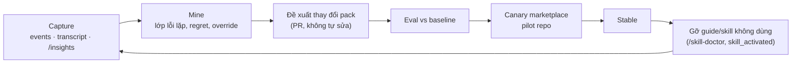

# 08 — Observability, eval, cải tiến liên tục

Component K9 và K11. Vấn đề neo: OBS-1, OBS-2, OBS-3, VER-3, EVL-1..4, DX-1, DX-2.

## 1. Telemetry: dùng của host, không dựng pipeline riêng

| Nguồn | Nội dung | Ghi chú |
|---|---|---|
| OTel của Claude Code | `claude_code.*` metrics (cost, token, session), events (`tool_decision`, `api_request`, `skill_activated`, `plugin_loaded`…), traces beta | Bật qua managed settings, thêm `team.id`, `service`. Content mặc định đã redact |
| Event log của kernel (K1) | event task, route, tier, gate, sensor, escalation | Nguồn sự thật cho metric harness |
| Telemetry bridge (K9) | ánh xạ event kernel sang OTel GenAI: `invoke_workflow` (task), `plan`, `execute_tool` (sensor), load-skill | Tên semconv còn ở trạng thái Development, nên mapping để ở một chỗ. `OTEL_*` không truyền xuống hook, nên exporter phải cấu hình tường minh |

Không có OTel collector thì metric vẫn tính được trực tiếp từ `events.jsonl` (local-first).

## 2. `claudehut status`: bề mặt trạng thái (DX-2)

Trả lời các câu user đang phải hỏi tay ("workflow có treo không", "hub còn unresolved không", "KB tự cập nhật chưa", "sao còn 0.9.0"):

```
claudehut status [--task <id>|--campaign <id>|--fleet] [--selftest]
  version     : kernel 0.20.3 (session 0.20.1 — restart để nhận bản mới)
  packs       : workflow-standard 0.20, lang-java-spring 0.20, org-summer 0.3.31 …
  task        : 0051 phase=review tier=T2 last_event 4m (no stall)
  knowledge   : index @a1b2c3 (HEAD), hub synced 12m, 0 unresolved
  sensors     : 14 active, 14 canary OK
  host        : auto mode, sandbox on, wrapper: rtk (adapted), advisor: opus
  campaign    : dr-featureflag 9/14 done, 2 blocked (wallet-ms: waiting approval)
```

## 3. Metric harness

Metric release là **test chạy định kỳ**, không phải dòng "đo sau phát hành" (OBS-2):

| Nhóm | Metric | Nguồn |
|---|---|---|
| Hiệu quả | cost/task và thời gian/task theo tier; tỉ lệ cache hit | OTel + events |
| Quy trình | phân bố route/tier (kể cả `direct`); số gate block, override; số escalation | events |
| Chất lượng | false-PASS (claim sai, verdict stale); task `done` vi phạm bất biến (mục tiêu 0); genericization do người ép; decision regret | events + `verify` + hub |
| Môi trường | tool error/tuần theo lớp (worktree refusal, glob zsh, wrapper); stall | transcript mining + events |
| Tri thức | độ tươi index/hub; tỉ lệ fact `useful`; số fact chưa xác minh ở fleet | K6 |
| Self-observability | % sensor có canary OK; hook/sensor không fire trong N ngày | K7 + K9 |
| Phân phối | số version đang chạy đồng thời; số bản copy asset trong repo | K10 + quét |

## 4. Eval (K11)

### 4.1 Sửa EVL-1 trước

- **Baseline bắt buộc.** Mọi suite chạy hai nhánh: có plugin và không plugin; báo Δ.
- **Budget đúng tầm.** 21/36 run cũ chết vì `--max-budget-usd`. Budget đặt theo tier của case; run bị cắt ghi `aborted`, không tính pass.
- **`is_error` đúng nghĩa.** Phân biệt lỗi hạ tầng với fail của case.
- **Chạy định kỳ, độc lập cách xác thực (Q1, Q7, K-17).** Mặc định chạy bằng quota plan: `claude plugin eval` không `--bare`, trên máy dev hoặc máy riêng đã đăng nhập, ngoài giờ. Có API key thì chạy được `--bare` và trong CI. Report ghi `auth_mode`; không trộn xu hướng giữa hai mode. Run chạm usage limit bị chấm 0, nên loại các run `partial` ([09 §7](09-adr-roadmap.md)).

### 4.2 Bốn suite

| Suite | Nội dung | Grader |
|---|---|---|
| **Outcome** | 20–50 task thật rút gọn: bug fix, feature, refactor, migration, trên fixture Spring và không Spring | test của fixture (chạy ngoài agent với `--keep-temp`), `file_exists`, `regex` |
| **Decision** | 24–30 case should/should-not abstract, pattern reuse, vendor leak ([a1](appendix/a1-decision-quality-evidence.md)) | ArchUnit ngoài agent, rubric `llm` cho từng chiều, judge khác model |
| **Process / invariant** | claim sai, verdict stale, `done` khi chưa review, AC chưa xác nhận | bất biến K2 phải chặn; `regex` trên event |
| **Env-hostile** | zsh, `FORCE_COLOR`, path có dấu cách, wrapper rtk, MCP vắng mặt, advisor vắng mặt, plugin workflow khác | không có refusal, không suy luận "không có" từ lỗi tool |

Mặc định threshold 1.0 trên 3 lần chạy, tức pass^3, cho regression. Judge được hiệu chỉnh trên ≥10 case do người chấm (đồng thuận ≥80%).

### 4.3 Ma trận nhánh

| Nhánh | Mục đích |
|---|---|
| Không plugin | baseline |
| 0.12.6 | xác nhận vấn đề |
| 0.20 (Sonnet) | hiệu quả harness |
| 0.20 (Sonnet + Opus advisor) | giá trị advisor |
| 0.20 (Opus) | trần |

## 5. Vòng cải tiến liên tục (EVL-4)



- Job mining chạy hằng tuần (routine, profile `dontAsk`, chỉ đọc). Output là báo cáo cộng PR nháp vào repo pack.
- **Không bao giờ tự sửa rule hoặc skill một cách âm thầm.** Thay đổi luôn qua PR, eval và canary.
- Điều kiện để thay đổi lên stable: suite liên quan không tụt, metric pilot đạt.
