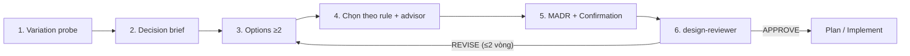

# A2 — Pack `deliberation`: vòng ra quyết định thiết kế

> Phụ lục. Capability C21 ([03 §2](../03-reference-architecture.md)), đóng gói thành pack ([06 §6](../06-quality-plane.md)). Phụ thuộc kernel: K2, K6, K11.

Mục tiêu: agent nhận ra khi nào đang đứng trước một quyết định thiết kế, thu fact trước khi chọn, cân nhắc phương án theo quy tắc kiểm được, ghi lại quyết định, và được một bên độc lập chấm. Chi phí chỉ phát sinh khi có rủi ro.

## 1. Tier rủi ro (thay router ba tuyến)

Route `direct | light | full` của v0.12 quyết định **lượng tài liệu**. Tier quyết định **mức cân nhắc**. Hai trục độc lập: task `light` vẫn có thể là T2 (ví dụ thêm provider nhưng ít file).

| Tier | Khi nào | Bắt buộc |
|---|---|---|
| T0 | Diff mô tả được trong một câu, không chạm trigger | Không chạy loop |
| T1 | Có thay đổi hành vi, chưa chạm trigger | Variation probe nhanh (3 câu hỏi, trả lời bằng tool) |
| T2 | Chạm ≥1 trigger (§2) | Decision brief, ≥2 phương án, quy tắc PV, MADR, advisor, design-reviewer |
| T3 | T2 cộng một trong: xuyên service, money path, contract public, đổi SDK/BOM, migration dữ liệu | T2 + tournament (hoặc debate, opt-in) + user xác nhận |

Router ghi tier thành event `tier.set` (`tier`, `tier_reasons[]`) trong `events.jsonl`; `task.json` chỉ là projection (K-03). Tier chỉ được hạ khi user đồng ý (giữ cách làm của ADR-R1).

## 2. Trigger nhận diện quyết định

Trigger tất định chạy trước (script, rẻ). Trigger do model đánh giá chạy sau.

| Trigger | Cách phát hiện | Case liên quan |
|---|---|---|
| Tích hợp bên ngoài mới (provider, bank, partner, kênh) | từ khoá trong yêu cầu + `kb_variation_points` tìm thấy họ cùng loại | N1, V1, P1 |
| Họ biến thể đã có (≥2 impl cùng interface, factory, registry `Map<String,X>`) | `kb_variation_points` | N1, W2 |
| Tên vendor sắp vào vị trí trung lập (enum, cột, `@ConfigurationProperties`, package domain) | `claudehut-verify vendor-leak` trên plan/diff, danh sách vendor lấy từ hub | V1, P3, P6 |
| Client thứ hai tới cùng service downstream | hub `links` + `kb_patterns("client")` | P5 |
| Enum/khóa được tái dùng cho nghĩa mới | model đánh giá + `kb_impact` | P2 |
| Phương án khuyến nghị khác phương án chọn | so sánh trong brief | W1 |
| Thay đổi hành vi theo site/mode (DR, feature flag) | profile + domain facts | N3, N4 |

## 3. Quy tắc Protected Variation hai chiều

Quy tắc này thay ladder minimalism một chiều của v0.12 (`minimalism.md:57-60`) và rung 0 của reuse-scanner. Nguồn: [02 §6](../02-research.md).

```
Dựng interface/port/strategy khi ÍT NHẤT MỘT điều đúng (ghi rõ điều nào):
  (a) code hiện có ≥2 biến thể cụ thể                 ← kb_variation_points
  (b) spec/ticket cam kết biến thể thứ 2 (lần này/kế) ← scale question
  (c) repo/hub đã có pattern cho đúng concern này      ← kb_patterns
Ngược lại: viết thẳng, giữ seam dễ refactor, ghi variation point hoãn vào ADR.
Xem lại khi: biến thể thứ 3 xuất hiện, hoặc (b)/(c) thành đúng.
```

| Tình huống | Kết luận | Finding nếu làm ngược |
|---|---|---|
| ZNS: repo có `SmsProviderFactory` (pattern), ZNS gắn cứng GapOne | (c) đúng → port `ZnsProvider` | "missing variation point (rule c)" |
| Export file ngân hàng: endpoint đã nhận `bank` | (b) đúng → template theo bank | "missing variation point (rule b)" |
| Một client nội bộ, không pattern, không cam kết | viết thẳng | "speculative abstraction" |
| if-chain theo `QrType` có 2 nhánh, repo có `EnumMap` strategy | (a) và (c) đúng → strategy | "missing variation point" |

Tách bạch: **tên vendor trong vị trí trung lập** (enum SDK, cột DB, properties dùng chung) là finding riêng, độc lập với quy tắc trên. Lý do: nó gây breaking change về sau dù chỉ có một vendor.

## 4. Các bước của loop



### 4.1 Variation probe (T1+, khoảng 1–2k token)

Ba câu hỏi, trả lời bằng tool chứ không bằng trí nhớ:

1. **Cái gì biến đổi ở đây?** Provider, bank, kênh, loại, site, tenant. Hiện có bao nhiêu biến thể (`kb_variation_points`)?
2. **Codebase đang xử lý biến đổi này thế nào?** Pattern và file mẫu (`kb_patterns`); quyết định cũ (`kb_decisions`).
3. **Quy mô sắp tới?** "Bao nhiêu provider/bank/kênh hiện có và sắp có?"
   - Không trả lời được từ repo/ticket: phiên tương tác hỏi bằng AskUserQuestion; headless ghi `[NEEDS CLARIFICATION]` thành giả định có cờ rủi ro, task không được tự lên T0.
   - Lỗi tool hoặc output rỗng ghi là `unknown`, không phải "không có" (case V6).

Kết quả: bảng `variation` trong `context.md`. Một trigger bật thì tier lên T2.

### 4.2 Decision brief (T2+, agent `framer`, opus high)

Các mục bắt buộc:
- **Forces / decision drivers**: yêu cầu, ràng buộc nghiệp vụ (domain facts), NFR.
- **Variation analysis**: kết quả probe kèm bằng chứng `path:line`.
- **Existing patterns**: pattern ID, file canonical, nơi đang lệch pattern.
- **Prior decisions**: ADR/D-n liên quan, còn hiệu lực hay đã bị thay thế.
- **Domain constraints**: luồng nghiệp vụ, producer/consumer từ hub, câu hỏi cho owner.

### 4.3 Options (≥2, có cấu trúc)

- Option 0 luôn là "theo pattern có sẵn" nếu `kb_patterns` tìm thấy. Option "viết thẳng" luôn có mặt làm đối chứng.
- Mỗi option có: cơ chế, rule PV thoả (a/b/c/none), chi phí lúc này, **chi phí khi thêm biến thể kế tiếp**, rủi ro, premortem một dòng.
- Chọn khác khuyến nghị thì phải ghi lý do (case W1).

### 4.4 Chọn và tham vấn

- Áp quy tắc PV. Model chỉ phán đoán khi hai option cùng thoả quy tắc.
- **Advisor** (nếu bật) được **khuyến nghị** qua prompt ở hai điểm: trước khi chốt option, và trước khi chuyển phase. Không ép được: không setting nào buộc hay giới hạn số lần gọi, và executor Opus/Sonnet 5.5 từ chối `tool_choice` ép buộc. Thời điểm gọi thực tế được đo ở nhánh advisor của eval ([08 §4.3](../08-observability-eval.md)). Loop không phụ thuộc advisor, vì advisor không có trên Bedrock/Vertex.
- **T3:** chạy workflow `design-tournament`. Mỗi option phác hoạ song song; judge khác model so từng cặp và **đảo thứ tự** (A-vs-B rồi B-vs-A), chỉ nhận verdict khi hai chiều khớp; output là JSON schema. Agent team debate là chế độ opt-in, không phải lõi (experimental, không chạy ở `-p`).

### 4.5 Ghi quyết định (MADR)

File `.claude/claudehut/decisions/NNNN-<slug>.md`, ghi qua `kb_record_decision` (writer duy nhất là `claudehut-state`):

```
---
id: DEC-0042  status: accepted  tier: T2  task: 0051
rule: [a, c]  variation_point: zns.provider
supersedes: []  valid_from: 2026-10-19
---
## Context and Problem Statement
## Decision Drivers
## Considered Options        (≥2; option 0 = existing pattern nếu có)
## Decision Outcome          (Chosen option: … because …)
## Consequences              (Good, because … / Bad, because …)
## Confirmation              (fitness function: ArchUnit rule / test name)
## Deferred variation points (nếu viết thẳng: điểm hoãn + điều kiện xem lại)
```

Quan hệ với spec v0.12: bảng §6 Decisions của spec trỏ tới DEC-id, không lặp lại nội dung. ADR-D2 bị thay (xem [09](../09-adr-roadmap.md)).

### 4.6 design-reviewer (lane mới, opus high, context mới)

Agent khác với người viết brief. Agent này chỉ đọc: brief, MADR, plan, kết quả `kb_*`. Rubric PASS/FAIL cụ thể:

| Tiêu chí | FAIL khi |
|---|---|
| R1 Rule PV | interface mới không thoả (a)–(c); hoặc thiếu interface khi (a)/(b) đúng |
| R2 Pattern | có pattern cho concern mà plan không theo và không giải trình |
| R3 Vendor leak | tên vendor trong enum, cột, properties hoặc package trung lập |
| R4 Scale | không trả lời câu hỏi quy mô, hoặc giả định không có cờ |
| R5 Domain | bỏ qua producer/consumer hoặc luồng nghiệp vụ mà domain facts có |
| R6 Confirmation | MADR không có fitness function kiểm được |

Nguyên tắc chống over-engineering (nguồn: best practices): chỉ R1–R6 được tính là finding chặn. Gợi ý ngoài rubric là tuỳ chọn.

## 5. Thay đổi trên các phần có sẵn

| Phần | Thay đổi |
|---|---|
| `minimalism.md` | Viết lại thành quy tắc PV hai chiều. Giữ phần chống dead code và flag thừa |
| reuse-scanner | Rung 0 không còn bỏ "speculative" khi (a)/(b)/(c) đúng; thêm cột "pattern family / variation point"; ghi layer của asset tái dùng (case V2) |
| brainstorm | Trigger không còn vòng tròn: tier T2 tự gọi brief (thay brainstorm), brainstorm chỉ còn cho bài toán mở |
| `task.md` (light) | Thêm mục `Variation` (3 dòng probe) và `DEC` khi T2 |
| spec template | §2 Goals/Non-goals/**Anti-goals** bắt buộc từ T2; §6 trỏ DEC-id |
| plan-review | Chạy cho mọi task T2+, không chỉ khi ≥5 task; effort high |
| reviewer | Bỏ dòng "Minimalism" một chiều, thay bằng R1/R3 của rubric; review hai tầng: tuân thủ spec, rồi chất lượng |
| headless | Không tự duyệt T2+. Ghi giả định và dừng ở gate `set-plan` với lý do, trừ khi có `--override` |

## 6. Chi phí ước lượng

| Tier | Chi phí thêm so với 0.12 |
|---|---|
| T0 | 0 |
| T1 | 1–3 lần gọi tool `kb_*`, khoảng 1–2k token |
| T2 | brief (opus) + 1 design review (opus) + advisor theo khuyến nghị (thường 1–2 lần, khoảng 1,5–3,5k token output advisor; đo ở eval) |
| T3 | thêm tournament 2–3 option, thường ≤6 agent |

Phải đo: tỉ lệ T2/T3 trên task thật (mục tiêu ≤35% T2, ≤10% T3) để tránh lặp lại tình trạng nặng nề của v0.11.
