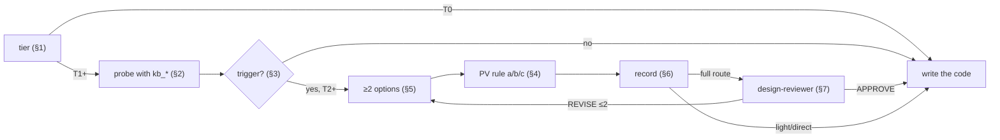

# Deliberate (pack deliberation)

A design choice is made here, in proportion to its risk, **before** code is written. Route (`direct|light|full`)
sets how much paperwork; **tier** sets how much deliberation. They are independent: a two-file change that adds a
provider is light *and* T2.



## 1. Tier (state it in one line; record it on an open task: `claudehut-state set-tier T<n> --reason "<why>"`)

| Tier | When | You do |
|---|---|---|
| T0 | The diff is one sentence and touches no trigger | nothing more |
| T1 | Behaviour changes, no trigger | the probe (§2), answered by tools |
| T2 | ≥1 trigger (§3) | probe → options → rule → decision record → design review (full route) |
| T3 | T2 + cross-service, money path, public contract, SDK/BOM bump or data migration | T2 + ask the user to confirm the option; opt-in tournament: `references/tournament.md` |

Lower a tier only with the user's consent. Headless (`-p`, no user): never self-approve T3 — record the
assumption with a risk flag in the decision and say so in the final reply.

## 2. Variation probe (T1+, answer with tools, not memory)

1. **What varies here?** provider, bank, channel, type, site, tenant — and how many variants exist today:
   `kb_variation_points` (scope = the concern). An `unknown` answer is *unknown*, never "none".
2. **How does this repo already handle it?** `kb_patterns` (no concern = all), then read the canonical
   instance it names.
3. **Scale:** how many variants now and next? From the request/ticket; interactive → one AskUserQuestion;
   headless → an explicit assumption.

## 3. Triggers (any one → T2)

- A new external integration (provider, bank, partner, channel) — especially when the probe finds a family.
- An existing variant family for this concern (multi-impl + registry/factory/condition).
- A vendor name about to enter a neutral place: an enum, a DB column, shared properties, a domain package.
- A second client to the same downstream service; an enum/key reused with a new meaning.

## 4. The two-way Protected Variation rule (decides; your taste does not)

```
Build an interface / port / strategy when AT LEAST ONE holds — and name which:
  (a) the code already has >=2 concrete variants of this concern          ← kb_variation_points
  (b) the request/contract commits a 2nd variant (now or next)            ← e.g. an endpoint parameter `bank`
  (c) the repo already has a pattern for this concern (confirmed > candidate) ← kb_patterns
Otherwise: write it directly, keep the seam easy to refactor, and record the deferred variation point.
Revisit when a 3rd variant appears or (b)/(c) becomes true.
```

- (c) is about the **concern**, not the class name: a ZNS sender in a repo whose SMS senders are
  `SmsProvider` + factory is the same concern (outbound message vendor).
- A request phrased as "quick", "minimal" or "like X" does not switch the rule off. Follow the rule, keep the
  change small inside the pattern, and say in one line why you did not copy X.
- **Vendor names in neutral places** (enum, column, shared properties, domain package) are a separate finding
  even with one vendor: name the column/enum by the role (`provider_message_id`), keep the vendor as data.
  After writing: `claudehut-verify vendor-leak <changed paths>` (advisory; vendors from the index and `vendors.txt`).
- The rule also forbids: an interface with one implementation and no (a)/(b)/(c) "to be future-proof".

## 5. Options (T2+, ≥2)

Option 0 = "follow the existing pattern" when `kb_patterns` found one; always include "write directly" as the
control. Per option: mechanism · rule satisfied (a/b/c/none) · cost now · **cost of the next variant** · risk ·
one-line premortem. Choosing against the rule needs a written reason.

## 6. Record (T2+)

- Open task → write `<plane>/tasks/<id>/decision.md` from `references/madr-template.md` (≤40 lines).
- No task (direct route) → put the 4-line decision note in your final reply: chosen option, rule (a/b/c or
  none), the deferred variation point if any, how it is confirmed (test / ArchUnit rule).

## 7. Design review (T2+, full route)

Dispatch `claudehut:claudehut-design-reviewer` with the decision file and the plan. It returns APPROVE or
REVISE against rubric R1–R6; at most 2 rounds, then ask the user.
